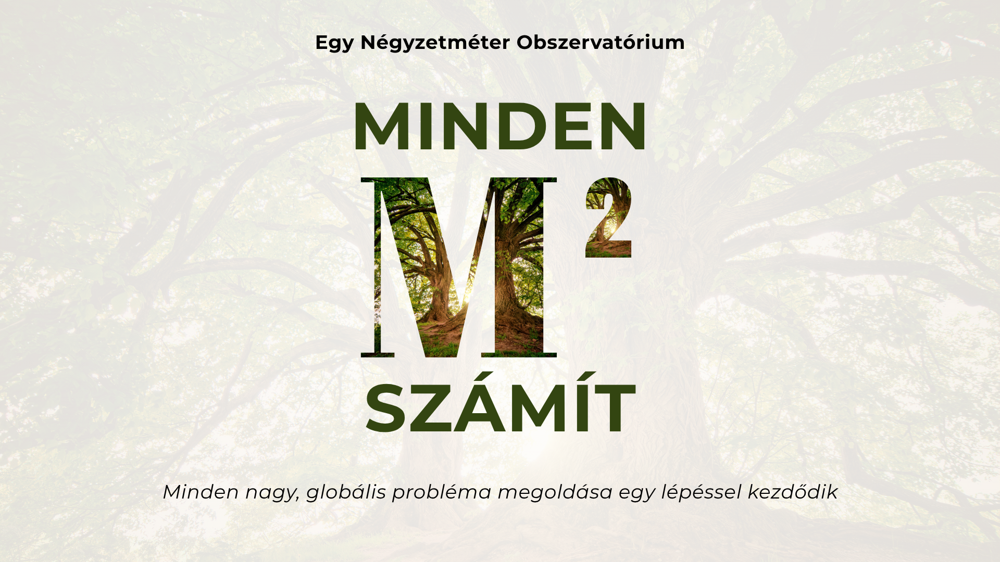

::: hero-kicker
*Globális környezeti kihívásokra keresünk megoldást, négyzetméterről négyzetméterre.*
:::

Figyeld meg a természetet ott, ahol élsz. Próbálj ki apró változtatásokat. Oszd meg, amit felfedeztél.

{fig-alt="Minden nagy, globális probléma megoldása egy lépéssel kezdődik"}

## Globális problémák. Helyi megoldások.

Az éghajlatváltozás, a biológiai sokféleség csökkenése, a városi hőség és a vízhiány globális kihívások. Hatásaikat azonban helyben tapasztaljuk meg — az erkélyeken, a kertekben, az iskolaudvarokon, a közparkokban és a természetjáró ösvények mentén.

Szeretnénk megérteni, mi történik ezen a nagyon kis léptéken, hogyan változik a környezet az idő múlásával, és milyen apró beavatkozások hozhatnak valódi eredményt. Az Egy Négyzetméter Obszervatórium (m²obs) egyetlen négyzetmétert alakít a megfigyelés, a kísérletezés és a közös tanulás helyszínévé.

## Mi lenne, ha a természet megóvása egyetlen négyzetméterrel kezdődne?

Az m²obs mindenkit arra hív, hogy váljon városi természetkutatóvá, és alakítsa a mindennapi környezetét a biológiai sokféleség és a klímaváltozáshoz való alkalmazkodás élő laboratóriumává. A kertektől és erkélyektől a tetőteraszokon és iskolaudvarokon át a közterületekig bárki örökbe fogadhat egy négyzetmétert, hogy megfigyelje a természetet, dokumentálja a környezeti változásokat, és egyszerű módszereket próbáljon ki környezete zöldebbé, hűvösebbé és ellenállóbbá tételére.

## Figyelj meg. Értsd meg. Cselekedj. Oszd meg.

1.  **Figyeld meg a természetet.** Kövesd nyomon a hőmérsékletet, a csapadékot, a növényzetet és a biológiai sokféleséget a saját négyzetmétereden.
2.  **Értsd meg a változásokat.** Fedezd fel, hogyan különböznek a természeti és helyi éghajlati viszonyok a kerted, az utcád, a városrészed négyzetméterein az egyes évszakokban.
3.  **Cselekedj.** Próbálj ki egyszerű, természetes beavatkozásokat, és figyeld meg, hogyan változik a négyzetméterenként a környezeted az idő múlásával.
4.  **Oszd meg a tudást.** Megfigyeléseiddel segítsd a lakosokat, a kutatókat és a városokat abban, hogy jobban megértsék a környezetünk változását és a természetes alkalmazkodást lehetőségét.

## Kérdések, amelyeket bárki kutathat

### Segíthetünk a fáknak több vizet megtartani?

Figyeld meg egy fiatal fa körül a talajt, hasonlítsd össze a talajviszonyokat, és próbálj ki megfelelő vízmegtartó megoldásokat.

### Találnak elegendő táplálékot a beporzók?

Számold meg a virágokat és a beporzó rovarok látogatásait egy kertben vagy parkban. Hasonlíts össze beültetett, lenyírt és kaszálatlan területeket.

### Hűvösebbé teheti a növényzet a környezetünket?

Hasonlítsd össze a burkolt, kavicsos és növényzettel borított területek felszíni hőmérsékletét. Vizsgáld meg, milyen apró, természetalapú beavatkozások segíthetnek.

### Hogyan jut be az esővíz a talajba?

Egyszerű csapadékmérővel és házilag elkészíthető beszivárgási teszttel hasonlítsd össze, hogyan nyelik el a vizet a különböző felszínek.

## Kis területek, fontos kísérletek

Egy iskolai osztály örökbe fogadhat egy fiatal közterületi fát, és az évszakok során rendszeresen visszatérhet hozzá. Egy család kaszálatlanul hagyhat egy négyzetméternyi gyepet, és megszámolhatja a virágzó növényeket. A szomszédok összehasonlíthatnak egy burkolt belső udvart egy növényekkel beültetett területtel. Iskolai csoportok vizsgálhatják a csapadékot, a víz beszivárgását, a hőmérsékletet és a biológiai sokféleséget.

## Közösen értelmezzük a változást

Célunk, hogy könnyen elsajátítható megfigyelési módszereket, egyszerűen használható digitális platformot, valamint kutatók és helyi közösségek nyitott hálózatát kapcsoljuk össze. A tudományos megfigyelési protokollok, az átlátható adatellenőrzés és az emberi felülvizsgálat azt szolgálják, hogy a megfigyelések megbízhatóak és újrafelhasználhatóak legyenek. Ugyanakkor a résztvevőknek is beleszólást szeretnénk biztosítani abba, hogyan értelmezzük és osztjuk meg a hozzájárulásaikat.

A Hágában és Budapesten tervezett kísérleti programokból kiindulva az m²obs célja, hogy a helyi megfigyeléseket szélesebb körű környezeti tudással, a kis léptékű kísérleteket pedig gyakorlati megoldásokkal kapcsolja össze. Ezek a kísérleti programok és a közös platform még fejlesztés alatt álló tervek, nem pedig már működő szolgáltatások.

[**Hogyan tudsz résztvenni?**](participate.qmd){.btn .btn-primary} [**Prezentáció letöltése (angol)**](https://m2obs.net/downloads/m2obs-introduction.pdf){.btn .btn-primary}

## Jövőképünk

Mindenki képes a világunk egy négyzetméterét megfigyelni. Mindenki képes egy négyzetmétert megváltoztatni. És arra is képes, hogy megállapítsa, jobb lett-e tőle a világ.

Négyzetméterenként meg lehet változtatni egy ágyást a járda szélén, egy háztetőt, egy parkot vagy akár egy mezőgazdasági birtokot.

Amit képesek vagyunk megfigyelni, azt képesek vagyunk megérteni is. Amit képesek vagyunk megérteni, azt meg is tudjuk változtatni. Együtt így meg tudjuk változtatni a környékünket. A településünket.

Négyzetméterenként is meg lehet változtatni a világot.
