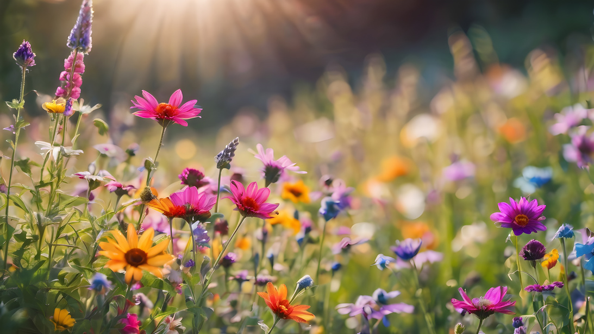

::: hero-kicker
*Wereldwijde milieuproblemen aanpakken, één vierkante meter tegelijk.*
:::

Observeer de natuur waar je woont. Probeer kleine veranderingen uit. Deel wat je ontdekt.

## Wereldwijde problemen. Lokale oplossingen.

Klimaatverandering, verlies aan biodiversiteit, hitte in de stad en waterschaarste zijn wereldwijde uitdagingen. Maar de gevolgen ervan ervaren we dichtbij huis — op balkons, in tuinen, op schoolpleinen, in openbare parken en langs wandelpaden in de natuur.

We willen begrijpen wat er op deze heel lokale schaal gebeurt, hoe dat in de loop van de tijd verandert en welke kleine ingrepen verschil maken. Het One Square Metre Observatory (m²obs) maakt van één vierkante meter een plek om te observeren, te experimenteren en samen te leren.

## Wat als het beschermen van de natuur begint met één vierkante meter?

m²obs nodigt iedereen uit om zelf natuuronderzoeker te worden en alledaagse plekken te veranderen in levende laboratoria voor biodiversiteit en klimaatadaptatie. Van tuinen en balkons tot dakterrassen, schoolpleinen en openbare ruimtes: deelnemers kunnen een vierkante meter adopteren om de natuur te observeren, veranderingen in hun leefomgeving vast te leggen en eenvoudige manieren uit te proberen om hun omgeving groener, koeler en beter bestand tegen klimaatverandering te maken.

## Observeren. Begrijpen. Handelen. Delen.

1.  **Observeer de natuur.** Houd de temperatuur, neerslag, begroeiing en biodiversiteit op jouw vierkante meter bij.

2.  **Begrijp veranderingen.** Ontdek hoe de natuur en het lokale klimaat verschillen van vierkante meter tot vierkante meter in je tuin, op je dak, langs je straat of in een nabijgelegen park — en hoe ze veranderen met de seizoenen.

3.  **Kom in actie.** Probeer eenvoudige, natuurgebaseerde ingrepen uit en observeer hoe je leefomgeving in de loop van de tijd verandert, vierkante meter voor vierkante meter.

4.  **Deel je kennis.** Draag met je waarnemingen bij aan een beter begrip van veranderingen in onze leefomgeving en help bewoners, onderzoekers en lokale gemeenschappen om natuurlijke manieren te vinden om zich aan te passen.

## Vragen die iedereen kan onderzoeken

### Kunnen bomen meer water vasthouden?

Observeer de grond rond een jonge boom, vergelijk de bodemgesteldheid en probeer geschikte maatregelen uit om water vast te houden.

### Vinden bestuivers voldoende voedsel?

Tel bloemen en bezoeken van bestuivers in een tuin of park. Vergelijk beplante, gemaaide en ongemaaide stukken groen.

### Kan groen een plek koeler maken?

Vergelijk de oppervlaktetemperaturen van bestrating, grind en beplante grond. Onderzoek welke kleine, op de natuur gebaseerde maatregelen kunnen helpen.

### Hoe dringt regenwater de bodem binnen?

Gebruik een eenvoudige regenmeter en een zelfgemaakte infiltratietest om te vergelijken hoe verschillende oppervlakken water opnemen.

## Kleine proefvlakken, betekenisvolle experimenten

Een schoolklas kan een jonge gemeentelijke boom adopteren en die gedurende de seizoenen blijven volgen. Een gezin kan een vierkante meter gazon ongemaaid laten en de bloeiende planten tellen. Buren kunnen een betegelde binnenplaats vergelijken met een beplante plek. Schoolgroepen kunnen onderzoek doen naar neerslag, waterinfiltratie, temperatuur en biodiversiteit.

## Burgerwetenschap voor iedereen

Onze ambitie is om toegankelijke observatiemethoden, een gebruiksvriendelijk digitaal platform en een open netwerk van onderzoekers en gemeenschappen samen te brengen. Wetenschappelijke protocollen, transparante gegevensvalidatie en menselijke beoordeling moeten ervoor zorgen dat waarnemingen betrouwbaar en herbruikbaar zijn. Tegelijkertijd krijgen deelnemers inspraak in de manier waarop hun bijdragen worden geïnterpreteerd en gedeeld.

Met geplande proefprojecten in Den Haag en Boedapest als vertrekpunt wil m²obs lokale waarnemingen verbinden met bredere milieukennis, en kleinschalige experimenten met praktische oplossingen. Deze proefprojecten en het gezamenlijke platform zijn nog in ontwikkeling en zijn nog geen bestaande diensten.

[**Ontdek hoe je kunt meedoen**](participate.qmd){.btn .btn-primary} [**Download presentatie (Engels)**](https://m2obs.net/downloads/m2obs-introduction.pdf){.btn .btn-primary}

## Onze visie

Iedereen kan één vierkante meter van onze planeet wél observeren. Iedereen kan die veranderen. Iedereen kan wél onderzoeken of die verandering zijn of haar leefomgeving beter heeft gemaakt.

Vierkante meter voor vierkante meter kun je je voortuin, je dak, een park of een stuk grond veranderen.

Wat we observeren, kan veranderen wat we begrijpen. Wat we begrijpen, kan veranderen wat we doen. Wat we samen doen, kan onze buurten veranderen. En onze buurten kunnen onze steden veranderen.

Kunnen we de wereld veranderen? Vierkante meter voor vierkante meter kan het wél.
