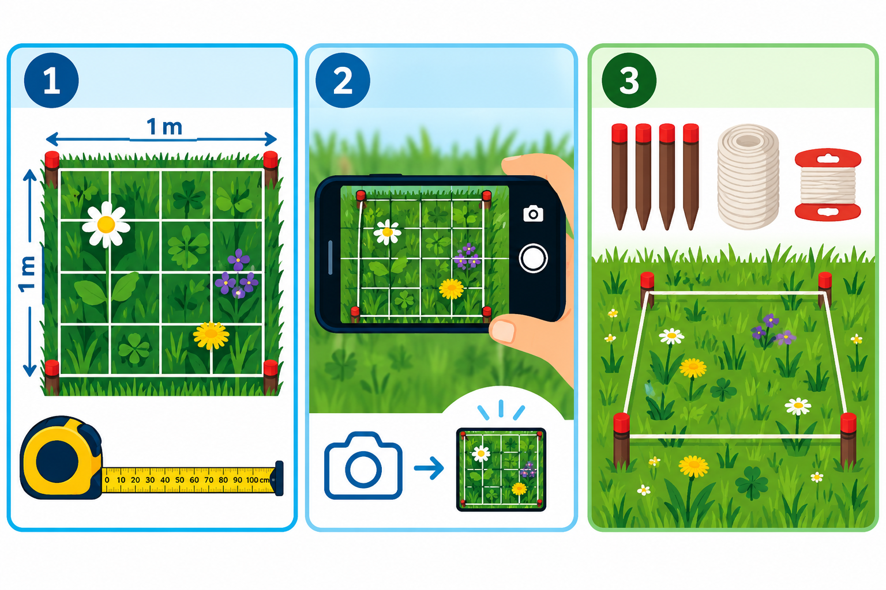
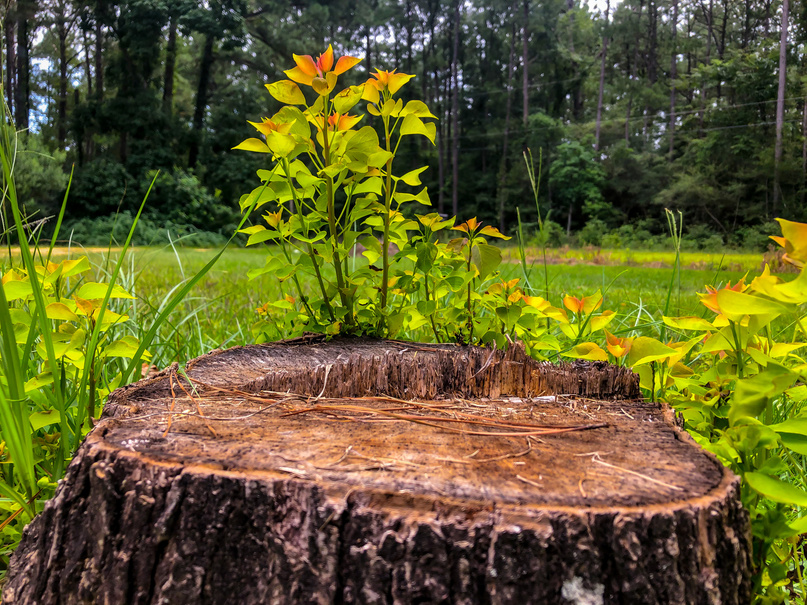

::: {.lead}
Figyeld meg a természetet ott, ahol élsz. Próbálj ki apró változtatásokat, alkalmazkodj együtt a természettel a klímaváltozáshoz. Oszd meg, amit felfedeztél.
:::

Bárkiből lehet városi természetkutató. Elkezdheted a saját kertedben, az erkélyeden vagy a tetőteraszon, egy iskolaudvaron vagy egy közös, nyilvános megfigyelőhelyen.

## Hogyan kezdj hozzá?

### 1. Jelöld ki a négyzetedet!

Négy egyméteres oldallal jelölj ki egy szabványos megfigyelési területet. Jelöld meg az oldalak felezőpontjait is, így egyszerű négyzethálót alakíthatsz ki. Ha a kerted szélén dolgozol, a négyzet egyik oldalát egy meglévő kerítés vagy más határvonal is kijelölheti.

### 2. Figyelj meg és fényképezz!

Jegyezd fel a növényeket, virágokat, beporzó rovarokat, a növényzet magasságát, a csapadékot vagy a talaj állapotát. Az időről időre megismételt fényképek és mérések segítségével dokumentálhatod a változásokat.

### 3. Kísérletezz és hasonlíts össze!

Helyezd az újra felhasználható mérőkeretet a fűre vagy a talajra. Hasonlíts össze egy lenyírt gyepet egy virágos réttel, vagy a csupasz talajt egy mulccsal takart területtel. Fedezd fel, hogyan befolyásolják a különböző körülmények és beavatkozások a négyzeted élővilágát és környezeti állapotát.

## Egyszerű eszközök. Közös tudomány.

Az alapkészlet négy újrahasznosított PVC-profilból vagy bambuszrúdból, egy mérőszalagból, zsinórból és egyszerű jelölőkből áll. Ezek az anyagok otthon is megtalálhatók, vagy bármelyik barkácsboltban beszerezhetők. További, választható eszköz lehet egy okostelefon, mérőrúd, hőmérő, csapadékmérő vagy házilag készített beszivárgásmérő gyűrű.

Terveink szerint nyíltan hozzáférhető útmutatókat teszünk közzé az eszközök házilagos elkészítéséhez, valamint a megfigyelési módszerekhez. A részvételnek soha nem lesz feltétele egy készlet megvásárlása.

## Mit kutathatsz?

- **Segíts a fáknak túlélni az aszályt!** Figyeld meg a talaj állapotát, és próbálj ki megfelelő vízmegtartó megoldásokat a városi fák körül. A fák egészségesebbé és kellemesebbé teszik környezetünket, de nem tudnak elmenekülni a rendkívüli hőség vagy a szárazság elől. Ha segítségre szorulnak, nekünk kell odamenni hozzájuk.
- **Adj több teret a beporzóknak!** Számold meg a virágokat, méheket, lepkéket és más beporzókat, és hasonlíts össze beültetett, lenyírt és kaszálatlan területeket. A beporzók méretükhöz képest rendkívül fontos szerepet játszanak abban, hogy a növények és az ökoszisztémák alkalmazkodni tudjanak az éghajlatváltozáshoz.
- **Tedd hűvösebbé a várost!** Hasonlítsd össze az aszfalt, a kavics, a fű és a növényekkel beültetett területek hőmérsékletét. Fedezd fel, hol segíthetnének apró változtatások mérsékelni a hőséget az otthonod körül, a lakónegyededben vagy akár az egész településen.
- **Segíts, hogy az esővíz eljusson a talajba!** Mérd a csapadékot, és hasonlítsd össze, milyen gyorsan szivárog be a víz a különböző felszíneken. Európa számos részén egyre kevesebb az eső és a hó, miközben a tömörödött vagy leromlott állapotú talaj nem engedi, hogy az értékes csapadékvíz beszivárogjon, mielőtt a hőségben elpárologna.

## A részvétel lépései

Az előzetes projektterv szerint a résztvevők először csatlakoznak a kezdeményezéshez, örökbe fogadnak egy négyzetmétert, kialakítják saját megfigyelőhelyüket, majd megfigyeléseket rögzítenek, tanulnak a visszajelzésekből, kisebb javításokat próbálnak ki, és másokat is meghívnak a részvételre. A regisztráció, az adatok feltöltése, az emlékeztetők és a személyre szabott visszajelzések egy jövőbeli online platform tervezett funkciói, nem pedig ezen az oldalon már elérhetőként ígért szolgáltatások.

## Hogyan vehetsz részt?

### Ha van kerted

Fogadj örökbe egy négyzetmétert a saját kertedben! Figyeld meg az élővilágot, mérd a helyi környezeti viszonyokat, és kísérletezz természetbarát megoldásokkal.

### Ha erkélyed vagy tetőteraszod van

Fedezd fel, mit lehet megfigyelni akár egy egészen kicsi szabadtéri területen is, a mérőkészlet megfelelő átalakításával.

### Ha nincs saját szabadtéri területed

Kapcsolódj be a parkokban, lakónegyedekben és más városi zöldterületeken tervezett közösségi megfigyelésekbe, egyénileg vagy csoportosan.

### Iskolák és diákok

Alakítsátok az iskolaudvar egy részét szabadtéri tanteremmé, ahol gyakorlati tapasztalatokat szerezhettek a biológiai sokféleségről, az éghajlatról és a tudományos megfigyelésről.

### Közösségi és környezetvédelmi szervezetek

Fogjátok össze az önkénteseket közös megfigyelőhelyek, ökológiai szaktudás, helyi környezeti monitoring és gyakorlati természet-helyreállítási tevékenységek köré.

## Mi történik a megfigyelésekkel?

A tervezett adatkezelési folyamat része a biztonságos adatgyűjtés, a dokumentált módszertan és adateredet, az automatizált minőségellenőrzés, az emberi felülvizsgálat, a megismételhető elemzés és az eredmények közérthető megosztása. Az adatok közzététele és újrafelhasználása során tiszteletben tartjuk a magánélet védelmét, a felhasználási engedélyeket és a közösségi adatkezelés szabályait. Ezek a fejlesztés alatt álló obszervatórium tervezési céljai.

## Működj együtt velünk!

Önkormányzatokkal, iskolákkal, környezetvédelmi szervezetekkel, kutatókkal, közösségi csoportokkal és támogatókkal keresünk együttműködési lehetőségeket, kezdetben a Hágában és Budapesten tervezett kísérleti programokhoz. A lehetséges hozzájárulások közé tartozik megfigyelőhelyek biztosítása, oktatási tevékenység, tudományos megfigyelési módszerek kidolgozása, önkéntesek bevonása, mérőkészletek rendelkezésre bocsátása és a helyi közösségi gondoskodás megszervezése.

Ha érdekel az együttműködés lehetősége, keresd **Antal Dánielt** (Budapest, Hága), a [Reprex](https://reprex.nl/contact/) oldalán keresztül, vagy **Asceline Grootot**, (Hága)  [hetkanWEL](https://hetkanwel.nl/contact/) oldalán keresztül.

[**Vissza az obszervatórium főoldalára**](index.qmd)