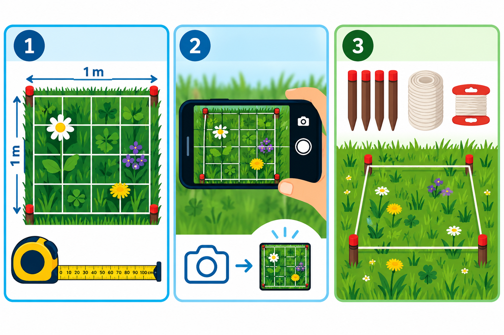
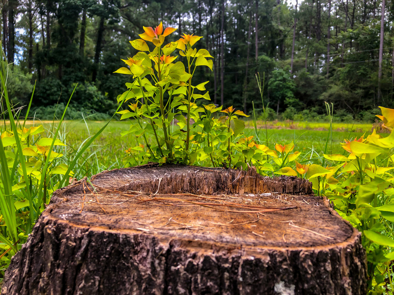

::: {.lead}
Observeer de natuur waar je woont. Probeer kleine veranderingen uit en ontdek hoe we ons samen met de natuur kunnen aanpassen aan klimaatverandering. Deel wat je ontdekt.
:::

Iedereen kan een stadsonderzoeker van de natuur worden. Je kunt beginnen in je eigen tuin, op je balkon of dakterras, op een schoolplein of op een gezamenlijke, openbare observatieplek.

## Hoe begin je?

### 1. Baken je vierkante meter af

Gebruik vier zijden van één meter om een standaard observatievlak af te bakenen. Markeer ook de middelpunten van de zijden om een eenvoudig raster te maken. Aan de rand van je tuin kun je een bestaande schutting of een andere begrenzing als één zijde van je vierkant gebruiken.

### 2. Observeer en fotografeer

Leg vast welke planten, bloemen en bestuivers je ziet, hoe hoog de begroeiing is, hoeveel regen er valt of hoe de bodem eraan toe is. Door regelmatig foto's en metingen te herhalen, kun je veranderingen in de loop van de tijd documenteren.

### 3. Experimenteer en vergelijk

Leg het herbruikbare meetkader op het gras of de bodem. Vergelijk een gemaaid gazon met een bloemenweide, of kale grond met een laag mulch. Ontdek hoe verschillende omstandigheden en ingrepen de natuur en de leefomgeving op jouw vierkante meter beïnvloeden.

## Eenvoudige hulpmiddelen. Samen wetenschap bedrijven.

De basisset bestaat uit vier hergebruikte PVC-profielen of bamboestokken, een meetlint, touw en eenvoudige markeringen. Deze materialen zijn vaak al in huis te vinden of verkrijgbaar bij een gewone bouwmarkt. Aanvullende hulpmiddelen zijn bijvoorbeeld een smartphone, meetlat, thermometer, regenmeter of een zelfgemaakte infiltratiering.

We zijn van plan vrij toegankelijke doe-het-zelfinstructies en observatieprotocollen te publiceren. Het kopen van een meetset zal nooit een voorwaarde zijn om mee te doen.

## Wat kun je onderzoeken?

- **Help bomen droogte te overleven!** Observeer de bodemgesteldheid en probeer geschikte maatregelen uit om water rond stadsbomen vast te houden. Bomen maken onze leefomgeving gezonder en aangenamer, maar kunnen niet vluchten voor extreme hitte of droogte. Als ze hulp nodig hebben, moeten wij naar hen toe.
- **Geef bestuivers meer ruimte!** Tel bloemen, bijen, vlinders en andere bestuivers, en vergelijk beplante, gemaaide en ongemaaide stukken groen. Bestuivers spelen een buitengewoon belangrijke rol bij het vermogen van planten en ecosystemen om zich aan klimaatverandering aan te passen.
- **Maak de stad koeler!** Vergelijk de temperaturen van bestrating, grind, gras en beplante oppervlakken. Ontdek waar kleine veranderingen kunnen helpen om de hitte rond je huis, in je buurt of in de hele stad te verminderen.
- **Help regenwater de bodem in!** Meet de neerslag en vergelijk hoe snel water in verschillende oppervlakken wegzakt. In veel delen van Europa valt steeds minder regen en sneeuw, terwijl verdichte of aangetaste bodems verhinderen dat kostbaar regenwater kan infiltreren voordat het door de hitte verdampt.

## Van deelnemer tot onderzoeker

Volgens het voorlopige projectplan begint deelname met het aansluiten bij het initiatief en het adopteren van een vierkante meter. Vervolgens richt je je eigen observatieplek in, leg je waarnemingen vast, leer je van de feedback, probeer je kleine verbeteringen uit en nodig je anderen uit om mee te doen. Registratie, het uploaden van gegevens, herinneringen en persoonlijke feedback zijn beoogde functies van een toekomstig online platform. Het zijn nog geen diensten die op deze pagina worden aangeboden.

## Hoe kun je meedoen?

### Als je een tuin hebt

Adopteer een vierkante meter in je eigen tuin! Observeer de natuur, meet de plaatselijke omstandigheden en experimenteer met natuurvriendelijke verbeteringen.

### Als je een balkon of dakterras hebt

Ontdek wat je zelfs op een heel kleine buitenruimte kunt observeren, met passende aanpassingen aan de meetset.

### Als je geen eigen buitenruimte hebt

Doe mee aan de geplande gezamenlijke observaties in parken, buurten en andere stedelijke groengebieden, alleen of met een groep.

### Scholen en leerlingen

Maak van een deel van het schoolplein een buitenlokaal waar leerlingen zelf aan de slag gaan met biodiversiteit, klimaat en wetenschappelijk observeren.

### Buurtinitiatieven en natuur- en milieuorganisaties

Breng vrijwilligers samen rond gezamenlijke observatieplekken, ecologische kennis, lokale monitoring en praktisch natuurherstel.

## Wat gebeurt er met de waarnemingen?

De beoogde gegevensverwerking omvat veilige gegevensverzameling, gedocumenteerde methoden en herkomst van gegevens, geautomatiseerde kwaliteitscontroles, menselijke beoordeling, reproduceerbare analyses en het toegankelijk delen van resultaten. Bij publicatie en hergebruik van gegevens houden we rekening met privacy, toestemmingen en afspraken over gemeenschappelijk gegevensbeheer. Dit zijn ontwerpdoelen voor het observatorium dat momenteel wordt ontwikkeld.

## Werk met ons samen!

We verkennen samenwerkingsmogelijkheden met gemeenten, scholen, natuur- en milieuorganisaties, onderzoekers, buurtinitiatieven en sponsors, in eerste instantie voor geplande proefprojecten in Den Haag en Boedapest. Mogelijke bijdragen zijn het beschikbaar stellen van observatieplekken, educatieve activiteiten, het ontwikkelen van wetenschappelijke observatieprotocollen, het betrekken van vrijwilligers, meetsets en het organiseren van lokaal beheer door de gemeenschap.

Wil je de mogelijkheden voor samenwerking verkennen? Neem dan contact op met **Daniel Antal** (Boedapest, Den Haag) via [Reprex](https://reprex.nl/contact/) of met **Asceline Groot** (Den Haag) via [hetkanWEL](https://hetkanwel.nl/contact/).

[**Terug naar het observatorium**](index.qmd)