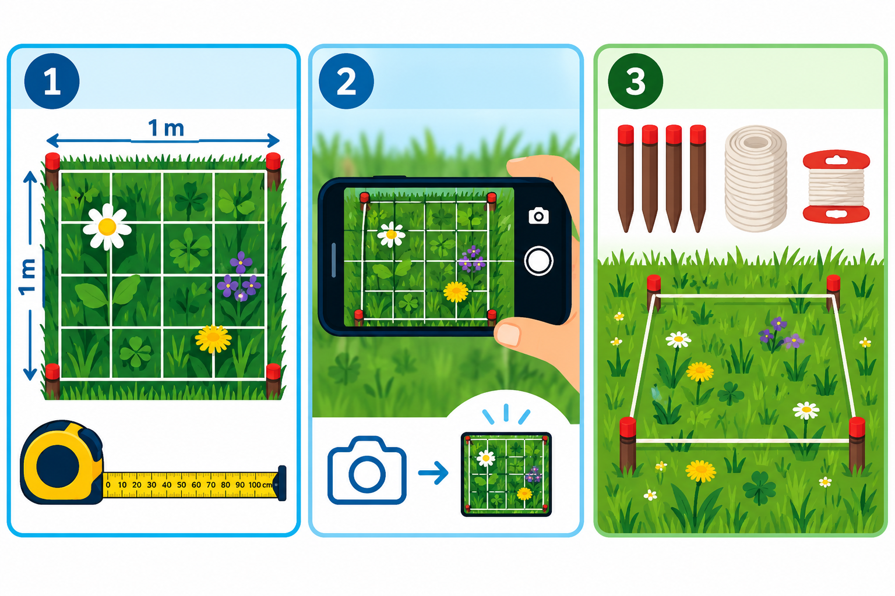
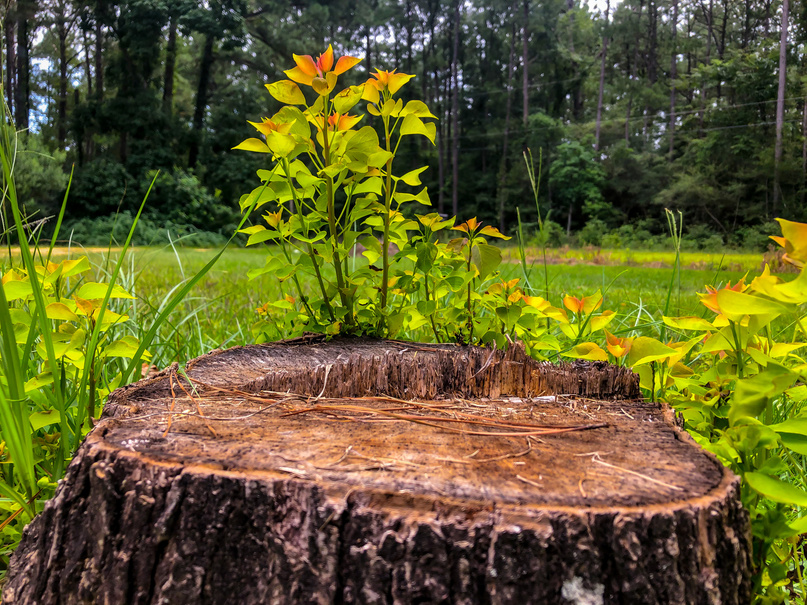

::: {.lead}
Observe nature where you live. Test small changes and see how you can adopt with nature to climate change. Share what you discover.
:::

Everyone can become an urban nature researcher. You can begin in a garden, on a balcony or rooftop, in a schoolyard, or at a shared public observation site.

## How to start

### 1. Mark your square

Use four one-metre edges to define a standard observation plot. Mark the halfway points to create a simple grid. Along the edge of your garden, you can use an existing fence or another boundary as one side of your square.

### 2. Observe and photograph

Record plants, flowers, pollinators, vegetation height, rainfall or soil conditions. Repeat photographs and measurements over time to document changes.

### 3. Test and compare

Place the reusable kit on grass or soil. Compare a mown lawn with a meadow, or bare soil with a mulched patch, to discover how different conditions and interventions affect your square.

## Simple equipment. Shared science.

The basic kit consists of four upcycled PVC profiles or bamboo sticks, a measuring tape, string and simple markers — materials readily available at home or in ordinary hardware stores. Optional tools include a smartphone, measuring rod, thermometer, rain gauge and homemade infiltration ring.

We plan to publish open DIY instructions and observation protocols. Buying a kit will never be a requirement for participation.

## What could you investigate?

- **Help trees survive drought.** Monitor soil conditions and test suitable water-retention measures around urban trees. Trees make our environment healthier and more pleasant, but they cannot escape extreme heat or drought. When they need help, we must come to them.

- **Create more space for pollinators.** Count flowers, bees, butterflies and other pollinators, and compare planted, mown and unmown patches. Pollinators play an outsized role in helping plants and ecosystems adapt to climate change.

- **Make cities cooler.** Compare temperatures across pavement, gravel, grass and planted areas. Discover where small changes could help reduce heat around your home, in your neighbourhood or across your town.

- **Help rainwater reach the soil.** Measure rainfall and compare how quickly water infiltrates different surfaces. In many parts of Europe, rain and snow are becoming scarcer, while compacted or degraded soils prevent precious rainwater from soaking in before it evaporates in the heat.

## Your participation journey

The preliminary project plan envisages a journey from joining the initiative and adopting a square metre to setting up an observatory, recording observations, learning from feedback, testing small improvements and inviting others to participate. Registration, uploading, reminders and personalised feedback are proposed functions of a future online platform, not services currently promised on this page.

## Ways to take part

### Residents with gardens

Adopt a square metre in your own garden to observe nature, measure local conditions and experiment with nature-friendly improvements.

### Balcony and rooftop residents

Explore what can be observed in even a small outdoor space, with suitable adaptations to the measurement kit.

### Residents without private outdoor space

Join observations at proposed public sites in parks, neighbourhoods and other urban green spaces, individually or with a group.

### Schools and students

Turn part of a schoolyard into an outdoor classroom for hands-on learning about biodiversity, climate and scientific observation.

### Community and environmental organisations

Bring volunteers together around shared observation sites, ecological expertise, local monitoring and practical nature restoration.

## What happens to observations?

The proposed data workflow includes secure collection, documented methods and provenance, automated quality checks, human review, reproducible analysis and accessible sharing of findings. Publication and reuse would respect privacy, permissions and community governance. These are design goals for the developing observatory.

## Cooperate with us

We are exploring collaborations with municipalities, schools, environmental organisations, researchers, community groups and sponsors, initially around proposed pilots in The Hague and Budapest. Potential contributions include observation sites, education, scientific protocols, volunteer engagement, measurement kits and local community stewardship.

For exploratory cooperation, contact **Daniel Antal,** [Reprex](https://reprex.nl/contact/) or Asceline Groot, [hetkanWEL](https://hetkanwel.nl/contact/).

[**Back to the observatory**](index.qmd)
